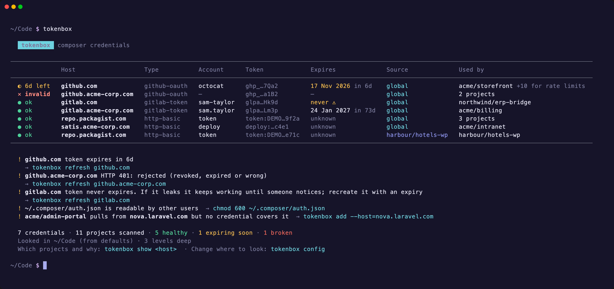

<p align="center">
  <picture>
    <source media="(prefers-color-scheme: dark)" srcset="docs/assets/logo-dark.svg">
    
  </picture>
</p>

<p align="center">
  See, check, refresh and create your Composer auth tokens across every repo and account.<br>
  <a href="https://codeeverything.github.io/tokenbox/"><strong>Website</strong></a> ·
  <a href="https://codeeverything.github.io/tokenbox/docs.html"><strong>Docs</strong></a>
</p>



tokenbox reads every Composer credential on your machine (global `auth.json`, per-project `auth.json` and `COMPOSER_AUTH`), checks each one live against its provider, and tells you what's broken, what's about to expire and which projects depend on it. Then it walks you through replacing it.

It ships as a command-line tool and a Composer plugin in one package. The plugin catches a dead credential during `composer install`, helps you create a new one and hands it to the running Composer, so the install carries on.

## Install

Requires PHP 8.2+ and Composer 2. tokenbox isn't on Packagist yet, so install it globally from this repository:

```bash
composer global config repositories.tokenbox vcs https://github.com/codeeverything/tokenbox
composer global config allow-plugins.tokenbox/tokenbox true
composer global require tokenbox/tokenbox:dev-main
```

Composer's global bin folder needs to be on your `PATH` (`composer global config bin-dir --absolute`). Leave out the `allow-plugins` line if you only want the command.

## Usage

```bash
tokenbox                    # every credential: health, account, expiry, where it's stored, what uses it
tokenbox show github.com    # one credential in full, and every project that uses it and why
tokenbox scan               # projects and the private hosts each needs: covered, missing or public
tokenbox add                # create a new credential: opens the provider's page, verifies, saves
tokenbox refresh <host>     # replace an expired or revoked credential in place
tokenbox status --json      # for CI and scripts; exits 1 if anything is expired or invalid
```

By default tokenbox scans `~/Code`, `~/Sites`, `~/Projects` and `~/src` plus the current folder. Point it elsewhere with `tokenbox config paths add <dir>`.

The [docs](https://codeeverything.github.io/tokenbox/docs.html) cover every command and option, [configuration](https://codeeverything.github.io/tokenbox/docs.html#config), [how health is checked](https://codeeverything.github.io/tokenbox/docs.html#health) for each provider, [the Composer plugin](https://codeeverything.github.io/tokenbox/docs.html#plugin), [JSON output](https://codeeverything.github.io/tokenbox/docs.html#json) and the [roadmap](https://codeeverything.github.io/tokenbox/docs.html#roadmap).

## Security

A secret is only ever sent to the host it's configured for, and output masks every token. Writes keep an `auth.json.bak` and set the file to `chmod 600`. There's no telemetry, account or on-disk cache. More in [the docs](https://codeeverything.github.io/tokenbox/docs.html#security).

## Development

```bash
git clone https://github.com/codeeverything/tokenbox && cd tokenbox
composer install
bin/tokenbox
```

```
bin/tokenbox                 entry point (Symfony Console)
src/Command/                 status, show, scan, add, refresh, remove, config
src/Workspace.php            finds projects and auth sources, works out coverage and usage
src/Checker.php              live health checks per provider
src/Wizard.php               the guided create → paste → verify flow, shared by CLI and plugin
src/Composer/                the plugin: hooks and the auth guard
docs/                        the website, served by GitHub Pages
demo/                        sandbox and recording scripts for the site's screenshots
```

To try your checkout as the global Composer plugin, swap the `vcs` repository above for `'{"type":"path","url":"/path/to/tokenbox"}'` and require `tokenbox/tokenbox:@dev`. Screenshots and videos on the site are recorded from the real CLI against demo data; see [demo/README.md](demo/README.md) to re-record them.

## License

MIT
